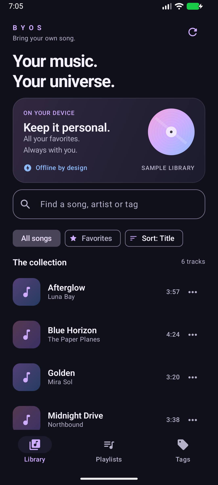
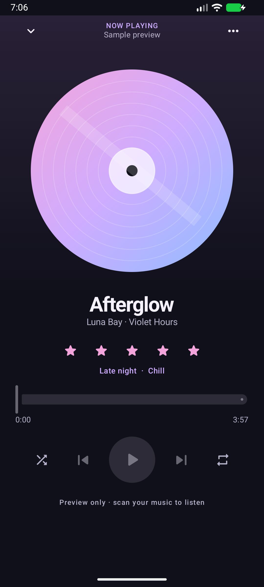
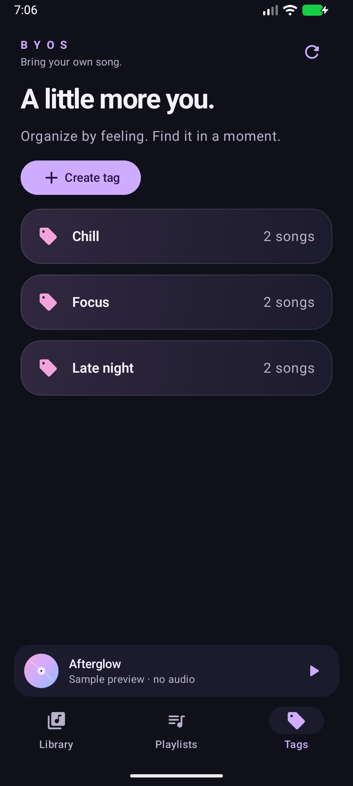
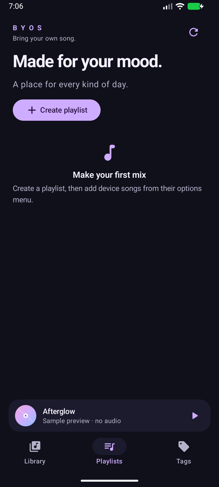

# Sprint 0 verification

Verified locally on 27 October 2026. The PR's Checks tab is the authoritative status for its current head; earlier failed runs are retained as debugging history.

## Local results

| Check | Observed result |
|---|---|
| Debug APK | Generated successfully with Java 17 / Gradle 8.9 / SDK 35 |
| Unit tests | 9 passed, 0 failures |
| Android lint | 0 errors; 33 dependency/toolchain-update warnings, tracked in Sprint 1 |
| Room instrumentation | 3 passed on API 37 emulator |
| Compose UI tests | 2 passed on API 37 emulator; CI also checks smaller API 26/35 devices |
| MediaStore scan | Indexed the generated 60-second PCM WAV test fixture |
| Playback | MediaSession reported PLAYING with the expected local-track metadata |
| Background service | PLAYING after Home; position advanced; foreground service type mediaPlayback, notification ID 1001 |
| System control | Media-session pause changed state to PAUSED at 5536 ms |
| Network requirement | Manifest has no INTERNET permission; playback used a local content URI |

Commands: `gradlew.bat testDebugUnitTest lintDebug assembleDebug connectedDebugAndroidTest`. XML/HTML reports are generated under `app/build/test-results` and `app/build/reports`; GitHub uploads its own reports. The test tone and raw emulator diagnostics remain untracked local QA artifacts, not user media.

## Screenshots

Actual 1080×2400 emulator captures of the Compose app, not mockups. Library/player/tags show labeled fictional samples; playlist screenshot shows the genuine empty state. Sample playback is intentionally disabled.

| Library | Now Playing |
|---|---|
|  |  |

| Tags | Playlists |
|---|---|
|  |  |

Reproduce sample mode in the **debug** build: `adb shell am start -W -n app.byos.android.debug/app.byos.android.MainActivity --ez preview true`. Normal launch uses device audio after permission; release ignores the preview intent extra.

## Artifact and provenance

Local APK: `app/build/outputs/apk/debug/app-debug.apk` (also copied to `artifacts/byos-0.1.0-sprint0-debug.apk`). GitHub Actions uploads a separate runner-signed debug APK; its checksum will differ because debug signing keys are environment-specific. CI artifacts expire after 14 days. A local checksum file is distributed with the local APK.

## Issues found and addressed

- Windows Java Unix-domain socket paths exceeded the usable temporary-path length. A shorter workspace temp directory allowed Gradle to run; no Android Studio work was delegated to the owner.
- API 26 lint caught an unsupported theme attribute; removed it. Added a dark Android 12+ splash and explicit dark system bars.
- Old Espresso used a removed InputManager reflection API on API 37. Updated test dependencies to Espresso 3.7.0, runner 1.7.0 and JUnit extension 1.3.0.
- UI selectors now distinguish search text from the song result, and verify Back navigation without assuming lazy content is visible on every screen size.
- Old CI SDK setup requested a removed `tools` package. Updated Actions and fixed the runner image to Ubuntu 24.04. PR updates trigger one workflow rather than duplicate push/PR runs.

## Access limits and release blockers

- A working emulator was available. No physical USB/Bluetooth/headset device was connected: real-hardware audio routing, battery, interruption and OEM behavior remain unverified. Minimum access for that work: a supported device with USB debugging enabled and this host authorized by ADB.
- The JPEG reference was accessible. No Figma/editable source or additional references were supplied; an editable design link/file would enable closer design matching.
- Play Console and production signing were not available or needed for Sprint 0. An owner-approved Play Console role, application ID and secure signing setup are required for a later release.
- Dependency upgrades/current Play requirements, branch-protection configuration, release/R8 tests, large-library performance, migrations and process-death restoration remain checklist/backlog items. This debug build is not production-ready.
